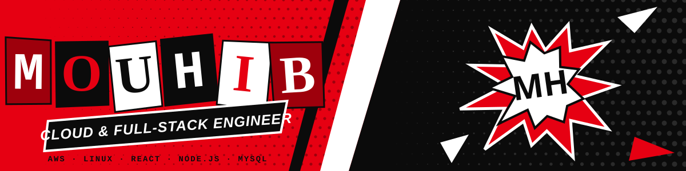
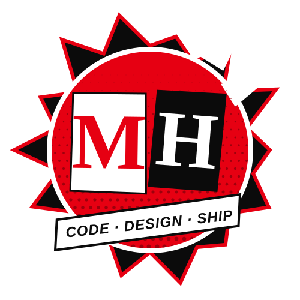
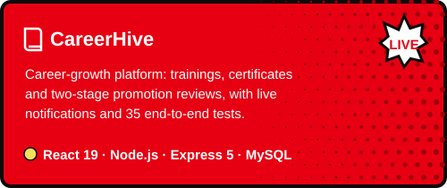

 

I'm a **4th-year engineering student specializing in Cloud & Infrastructure** at TEK-UP University, Tunisia, and a **full-stack developer** who builds with `React` and `Node.js` and takes apps all the way to production. I hold a Licence in Business Computing (`E-Business`) from ISAAS Sfax.

I like apps that are **polished on the front**, **secure and tested on the back**, and **properly deployed**. During my **2025 internship at Medianet** I built the first version of **CareerHive**, a career-growth platform, then rebuilt it end to end on `Express 5` and shipped it across `Vercel`, `Render` and `Aiven MySQL`: 13 screens, 70 API routes, OAuth sign-in, live notifications and 35 end-to-end tests.

Since **2024** I've also worked as a **freelance web developer**, taking client websites from first brief to launch. Right now I'm doing hands-on `AWS` labs, preparing for **AWS Cloud Practitioner** and learning `TypeScript`. I'm **open to remote cloud, full-stack and React roles**.

 

**You can click here**

 

> [!CAUTION]
> Every project here is live, tested and documented.
>
> Open the app, read the code, break something. That's how it gets better.

 

 

<table>
<tr>
<td width="50%" valign="top" align="center">

</td>
<td width="50%" valign="top" align="center">

</td>
</tr>
</table>

<b>More projects</b>

 

- **[Aura Store](https://github.com/HMMOUHIB/Aura-Store):** fashion e-commerce with catalog and search, email-verified sign-up, an admin dashboard and an AI-assisted chatbot. `PHP` `JavaScript` `MySQL`
- **[Personal portfolio](https://github.com/HMMOUHIB/HM-PORTFOLIO):** motion-first site with a Three.js particle hero and GSAP ScrollTrigger sections. `React` `Three.js` `GSAP`
- **Nexos Game Shop:** game marketplace with a Spring Boot REST backend. `Java 21` `Spring Boot` `MySQL`

