<div align="center">




<br/>

<a href="https://career-hive-ebon.vercel.app"></a>
<a href="https://www.linkedin.com/in/hmazaoui-mouhib/"></a>
<a href="mailto:hamzaouimoh54@gmail.com"></a>


</div>


## ◆ About me

```yaml
name:            Mouhib Hamzaoui
role:            Frontend & Full-Stack Developer
studies:         4th-year engineering, Cloud & Infrastructure @ TEK-UP University, Tunisia
previous_degree: Licence in Business Computing (E-Business), ISAAS Sfax
languages:       English · French · Tunisian Darija

experience:
  - Full-Stack Developer Intern @ Medianet (2025): built the first version of CareerHive
  - Freelance Web Developer (2024 – present): websites and landing pages for clients

looking_for:     Remote junior frontend / React roles
learning_now:    TypeScript · AWS Cloud Practitioner → Solutions Architect Associate
```

I build web apps that are **solid underneath and polished on screen**: clean REST APIs, secure sign-in and tested code on the back end; fast, responsive and motion-aware interfaces on the front end.


## ◆ Tech stack

<div align="center">

**Frontend & motion**<br/>


**Backend & APIs**<br/>


**Data, cloud & tools**<br/>


**Design & creative**<br/>


</div>


## ◆ Featured projects

### 🐝 CareerHive · career-growth platform

<a href="https://career-hive-ebon.vercel.app"></a>
<a href="https://github.com/HMMOUHIB/Career_Hive"></a>
<a href="https://github.com/HMMOUHIB/Career_Hive/blob/main/presentation/pdf/CareerHive-Project-Book.pdf"></a>

Employees follow trainings, collect certificates and request promotions; HR reviews each request, then the manager decides. Started during my 2025 internship at Medianet (React + Symfony), then rebuilt end to end on Node.js.

<a href="https://career-hive-ebon.vercel.app"></a>

`React 19` `Vite` `Node.js` `Express 5` `MySQL` `Three.js`

- **13 screens · 70 API routes · 23 tables**, with a Context + reducer store that refreshes on server events
- **Secure accounts:** JWT sessions, Google / LinkedIn / GitHub OAuth, bcrypt, rate-limited sign-in
- **Live notifications** over Server-Sent Events, with a polling fallback
- **35 end-to-end API tests**; deployed on Vercel, Render and Aiven MySQL

---

### 🛍️ Aura Store · fashion e-commerce platform

<a href="https://github.com/HMMOUHIB/Aura-Store"></a>

A full-stack online fashion store with a cinematic homepage, product catalog and search, email-verified sign-up, an admin dashboard and an AI-assisted shopping chatbot.

`PHP` `JavaScript` `MySQL` `HTML` `CSS`

---

### 🎬 Personal portfolio · motion-first website

<a href="https://github.com/HMMOUHIB/HM-PORTFOLIO"></a>

A cinematic portfolio with a Three.js particle hero, an orbital skills map, scramble-text and parallax effects, told through GSAP ScrollTrigger sections.

`React` `Three.js` `GSAP` `Lenis`

---

### 🎮 Nexos Game Shop · game marketplace

A gaming marketplace with a Spring Boot REST backend and neon cyberpunk sign-in screens.

`Java 21` `Spring Boot` `MySQL` `REST API`


## ◆ GitHub activity

<div align="center">


</div>


## ◆ Roadmap

- [x] Full-stack web development (React + Node.js, React + Symfony)
- [x] Motion-first frontends (GSAP, Three.js, Lenis)
- [x] Relational database design (23-table MySQL schema)
- [x] Deployed a full-stack app with 35 end-to-end tests (Vercel · Render · Aiven)
- [ ] TypeScript across my React projects
- [ ] AWS Cloud Practitioner (CLF-C02)
- [ ] AWS Solutions Architect Associate
- [ ] IELTS
- [ ] DevOps automation & Kubernetes

<div align="center">

<br/>

**Hiring for a remote frontend or React role? Let's talk.**

<a href="mailto:hamzaouimoh54@gmail.com"></a>
<a href="https://www.linkedin.com/in/hmazaoui-mouhib/"></a>

</div>


